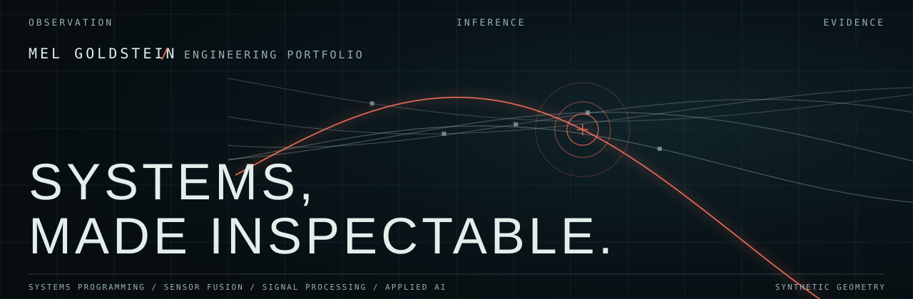

## [melgoldstein.com](https://melgoldstein.com/)

I’m Mel Goldstein, working across systems programming, sensor fusion, signal processing, and applied AI. I’m an aspiring data science / forward-deployed engineer focused on inspectable evidence, explicit limits, and reproducible implementation.

## Selected engineering work

### 01 / [Maritime ISR — anomaly detection](https://github.com/melgoldstein/isr-maritime-threat-ml)

Causal kinematic features and calibrated anomaly scoring over synthetic AIS/radar observations, with typed review records and explicit field-performance limits.

---

### 02 / [Multi-sensor track fusion EKF](https://github.com/melgoldstein/multi-sensor-track-fusion-ekf)

Four-state tracking of asynchronous radar range/bearing and optical bearing reports, with Mahalanobis gating, nearest-neighbor association, and a C99 Joseph covariance update.

---

### 03 / [Zero-copy SPSC ring buffer](https://github.com/melgoldstein/zero-copy-ringbuffer-ipc-c)

A fixed-capacity shared-memory queue in C99, using in-place slots, acquire/release ordering, separate cache-line counters, and Linux cross-process verification.

---

### 04 / [Local ontology and audit ledger](https://github.com/melgoldstein/foundry-ontology-local)

A local typed-object graph with deterministic agent actions, atomic revision-checked transactions, idempotent replay, and hash-chained audit receipts using Pydantic and DuckDB.

---

### 05 / [Bounded-memory LLM stream guardrail](https://github.com/melgoldstein/c-llm-guardrail)

A C99 stream checker for secret-like tokens, literal injection signatures, and JSON bracket/string structure, with sticky chunk-spanning flags and a Python `ctypes` harness.

---

### 06 / [Space-defense OSINT MCP server](https://github.com/melgoldstein/mcp-space-defense-osint)

A stdio MCP server for CelesTrak satellite passes, NOAA space weather, and NOTAM-derived GeoJSON envelopes, with explicit cache, timeout, and freshness behavior.

[Browse all repositories](https://github.com/melgoldstein?tab=repositories)
