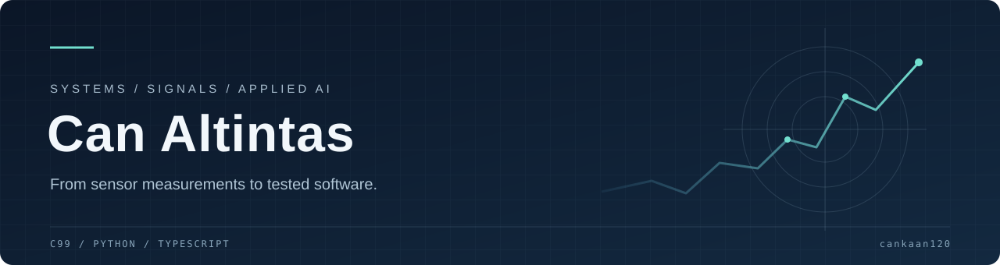

[Portfolio: melgoldstein.com](https://melgoldstein.com/)

I build C and Python tools for sensor processing, machine learning, and inspectable AI workflows. My projects connect low-level systems work with the numerical methods and validation needed to make their outputs useful.

**C99 / Python / TypeScript** &nbsp; · &nbsp; **Signal processing / Sensor fusion / AI infrastructure**

## Selected engineering work

| Project | What it does | Engineering focus |
| :--- | :--- | :--- |
| [Maritime threat ML](https://github.com/melgoldstein/isr-maritime-threat-ml) | Scores anomalous AIS/radar tracks and maps alerts into ontology contracts. | Calibration, ablations, model artifacts, API review workflow |
| [Zero-copy IPC](https://github.com/melgoldstein/zero-copy-ringbuffer-ipc-c) | Moves messages through an allocation-free shared-memory queue. | C99, acquire/release ordering, cross-process verification |
| [Multi-sensor EKF](https://github.com/melgoldstein/multi-sensor-track-fusion-ekf) | Fuses asynchronous radar and optical reports into tracks. | Native matrix core, Mahalanobis gates, covariance checks |
| [Local ontology framework](https://github.com/melgoldstein/foundry-ontology-local) | Models typed objects, links, and transactional agent actions locally. | Pydantic, DuckDB, preconditions, verifiable audit chains |
| [LLM stream guardrail](https://github.com/melgoldstein/c-llm-guardrail) | Checks streaming text for secret-like tokens, injection signatures, and JSON structure. | Bounded-memory C scanner, Python API, measured latency |
| [Aerospace MCP server](https://github.com/melgoldstein/mcp-space-defense-osint) | Exposes satellite passes, space weather, and airspace geometry to agents. | MCP interoperability, external-feed validation, reproducible tests |

## How I approach the work

- **Make behavior inspectable.** Explicit units, typed boundaries, and actionable failures.
- **Measure the whole path.** Include wrapper costs and publish benchmark conditions.
- **Test the uncomfortable cases.** Truncated inputs, stale observations, covariance failures, and concurrent updates.

The repositories include their own setup instructions, test commands, and implementation limits. For a quick technical review, start with a selected project's README, then its tests and CI workflow.

<strong>Explore the full project collection</strong>

### AI tooling and evaluation

[Ontology drift monitor](https://github.com/melgoldstein/aip-ontology-drift-monitor) · [Grounded retrieval evaluation](https://github.com/melgoldstein/aip-tactical-rag-eval)

### Signals and trajectories

[ADS-B trajectory clustering](https://github.com/melgoldstein/adsb-trajectory-clustering-ml) · [Acoustic spectral features](https://github.com/melgoldstein/acoustic-sonar-doppler-fft) · [Radar return classification](https://github.com/melgoldstein/radar-rcs-target-classifier) · [UAV telemetry anomalies](https://github.com/melgoldstein/uav-telemetry-anomaly-c)

### Focused engineering utilities

[Altimeter Kalman filter](https://github.com/melgoldstein/kalman-1d-altimeter-filter-c) · [NMEA checksum parser](https://github.com/melgoldstein/nmea-0183-sentence-checksum-c) · [TLE orbital calculator](https://github.com/melgoldstein/TLE-orbital-period-calc) · [PCAP UDP inspector](https://github.com/melgoldstein/pcap-udp-telemetry-header-dump) · [Trajectory integrator](https://github.com/melgoldstein/ballistic-trajectory-sim-c) · [Weather window parser](https://github.com/melgoldstein/eastern-range-weather-parser)

---

Questions about an implementation? Open an issue in the relevant repository with a minimal example.
